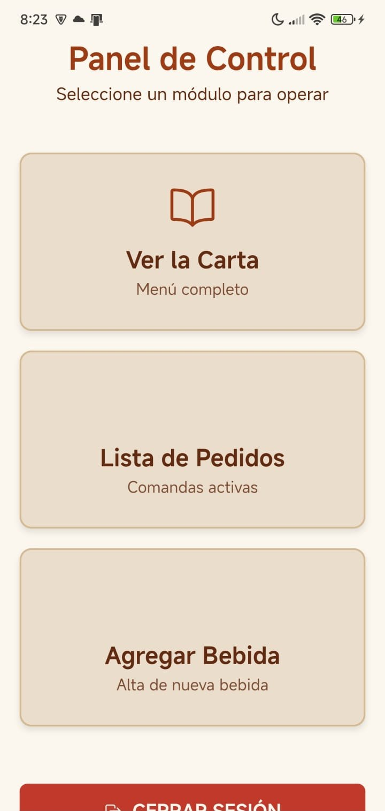
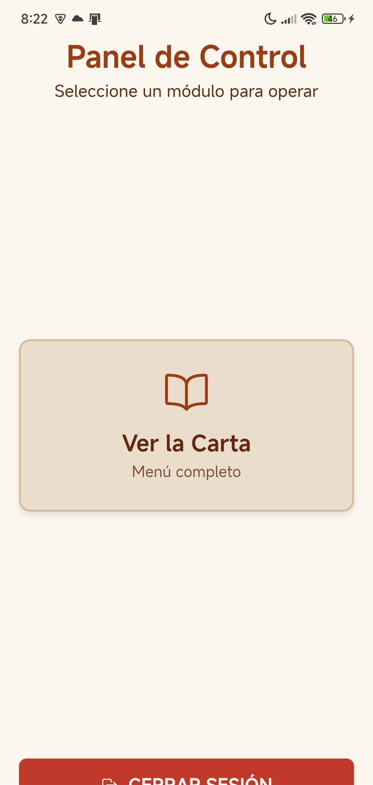
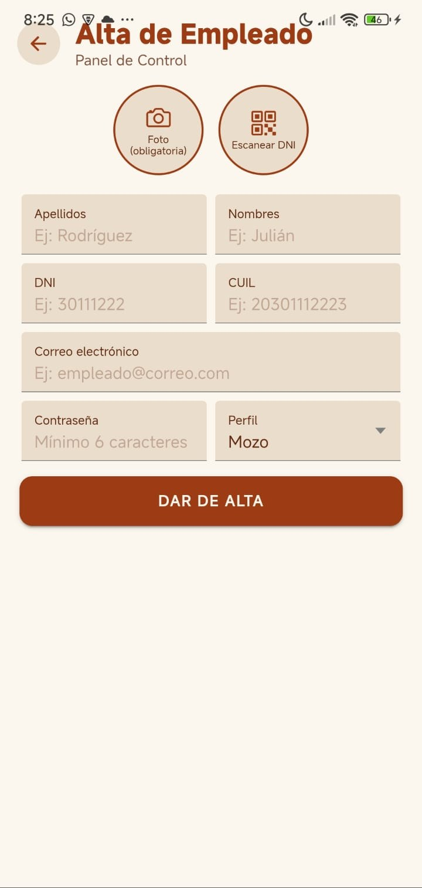
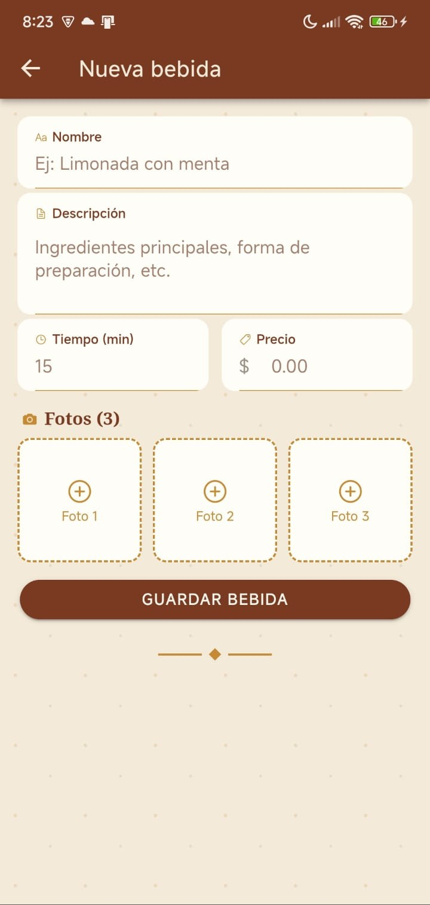
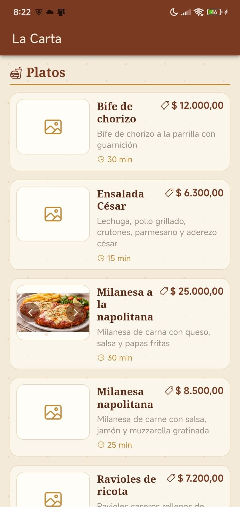

# LA MESA — Comanda QR

### Trabajo Final Integrador · Tecnicatura Universitaria en Programación · UTN

Aplicación móvil para la gestión integral de un restaurante mediante códigos QR.

---

## Índice

- [Descripción del Proyecto](#descripción-del-proyecto)
- [Integrantes](#integrantes)
- [Tecnologías Utilizadas](#tecnologías-utilizadas)
- [Organización del Equipo](#organización-del-equipo)
- [Estado Actual del Proyecto](#estado-actual-del-proyecto)
- [Capturas e Imágenes](#capturas-e-imágenes)
- [Base de Datos](#base-de-datos)

---

## Descripción del Proyecto

Aplicación móvil desarrollada como Trabajo Final Integrador de la Tecnicatura Universitaria en Programación de la UTN.

El sistema permitirá gestionar el funcionamiento de un restaurante mediante el uso de códigos QR, contemplando distintos perfiles de usuario:

| Perfil | Perfil | Perfil |
|---|---|---|
| Dueño | Metre | Cocinero |
| Supervisor | Mozo | Cantinero |
| Cliente | | |

---

## Integrantes

| Integrante |
|------------|
| Ezequiel Bainer |
| Maximiliano Arcieri |
| Noelia Storgato |
| Lucía Cicchelli |

---

## Tecnologías Utilizadas

---

## Organización del Equipo

### Estrategia de Ramas

| Rama | Uso |
|---|---|
| `main` | Rama estable. Solo recibe merges desde `dev` ya probados. |
| `dev` | Rama de integración. Ahí se mergean las ramas individuales para probar que todo funcione antes de pasar a `main`. |
| `Bainer`, `Arcieri`, `Storgato`, `Cicchelli` | Ramas personales de cada integrante para el desarrollo de sus módulos. |

### Integrantes y Módulos

| Integrante | Branch | Período | Módulos desarrollados |
|---|---|---|---|
| **Ezequiel Bainer** | `Bainer` | 28/08/2026 – En progreso | 

Ver detalle
<ul><li>Creación y administración del repositorio GitHub.</li><li>Organización general del proyecto.</li><li>Actualización y mantenimiento del README.</li><li>Investigación inicial de Ionic.</li><li>Investigación inicial de Android Studio.</li><li>Investigación inicial de Capacitor.</li><li>Alta de mesa (punto 4): formulario con foto por cámara y generación de QR.</li><li>Listado y gestión de mesas (punto 4): alternar disponibilidad, refresco automático de la lista al volver del alta, guard de ruta por perfil (dueño/supervisor).</li><li>Validaciones del formulario de alta de mesa: mensajes de error visibles por campo, foto obligatoria, bloqueo de notación no numérica (<code>e</code>/<code>+</code>/<code>-</code>) en los campos de número y comensales.</li><li>Correcciones de diseño de la preentrega del 13/09 en home, login, registro de cliente, alta de empleado, alta y gestión de mesas y carta.</li><li>Regeneración del ícono y del splash de la app a partir de los assets fuente.</li><li>Accesos rápidos del login traídos desde la base de datos (foto, perfil y nombre de cada usuario).</li><li>Consulta al mozo (punto 11): carta abierta desde el QR de mesa, chat en tiempo real entre cliente y mozos, y bandeja del mozo con las mesas que tienen consultas sin responder.</li><li>Validación de que el QR escaneado sea el de la mesa asignada al cliente (punto 10).</li><li>Notificaciones al dueño/supervisor por clientes pendientes, a los mozos por consultas nuevas y al cliente cuando el mozo le responde.</li><li>Botón para volver a ver el QR de una mesa ya creada.</li></ul>
 |
| **Maximiliano Arcieri** | `Arcieri` | 28/08/2026 – En progreso | 

Ver detalle
<ul><li>Configuración inicial de Supabase.</li><li>Diseño de entidades.</li><li>Creación del esquema inicial de base de datos.</li><li>Implementación de autenticación.</li><li>Configuración de políticas RLS.</li><li>Pantalla de dueño/supervisor con listado de clientes pendientes y botones aceptar/rechazar (integrada con las políticas RLS).</li><li>Filtrado del panel de control por perfil (dueño/supervisor ven clientes pendientes; cocinero/cantinero ven solo la card de lista de pedidos).</li><li>Base de datos para alta de empleados (punto 1): índices únicos parciales de DNI/CUIL/email y policy de Storage para que dueño/supervisor suban la foto de un empleado nuevo.</li><li>Alta de empleados (punto 1) completa: Edge Function <code>crear-empleado</code>, service, página de formulario, guard de ruta y card de acceso en el panel para dueño/supervisor.</li><li>Fix de compresión de foto: la imagen de la cámara superaba el límite de 5 MB del bucket <code>fotos</code> de Storage; se resolvió redimensionando/comprimiendo antes de subir (<code>imagen.util.ts</code>, pensado para reusarse en mesas y productos).</li><li>Integración final de <code>dev</code>: unificó los puntos 2/3 (alta de plato/bebida) de Cicchelli con el punto 1 (alta de empleado) propio.</li><li>Metre asigna mesa (punto 10): vínculo cliente–mesa en la base de datos, lista de espera del metre y anotación del cliente registrado.</li><li><code>NotificacionesService</code> con <code>@capacitor/local-notifications</code>: aviso al metre por clientes nuevos en la lista de espera y al cliente cuando se le asigna mesa.</li></ul>
 |
| **Noelia Storgato** | `Storgato` | 28/08/2026 – En progreso | 

Ver detalle
<ul><li>Formulario de Login.</li><li>Pantalla de accesos rápidos.</li><li>Implementación de Logout.</li><li>Guards de ruta por perfil.</li><li>Creación del proyecto Ionic.</li><li>Flujo de cliente registrado: pantalla de alta, estado "pendiente" y notificación visual del cambio de estado.</li><li>Migración de las pantallas de registro a Signals para reflejar los datos de Supabase sin depender de zone.js.</li><li>Mascotas ilustradas en las pantallas de Login y Registro de cliente.</li><li>Escaneo de DNI argentino (código PDF417 del dorso) con ML Kit para autocompletar nombre, apellido y DNI en el registro de cliente.</li><li>Envío automático de mails (Brevo) para los estados pendiente, aceptado y rechazado del cliente (puntos 5, 7 y 8), desde Edge Function.</li><li>Fix de seguridad: un cliente pendiente o rechazado no puede entrar al home.</li><li>Ingreso de cliente anónimo (punto 9): escaneo del QR de entrada, alta con nombre y foto, y lista de espera.</li><li>Unificación del CSS con variables compartidas y limpieza de colores hardcodeados en varias pantallas.</li></ul>
 |
| **Lucía Cicchelli** | `Cicchelli` | 28/08/2026 – En progreso | 

Ver detalle
<ul><li>Diseño del ícono de la aplicación.</li><li>Desarrollo de la pantalla de inicio (Splash Screen) estática y animada para el sistema "LA MESA".</li><li>Maquetación modular utilizando Angular y SCSS con paleta cromática temática.</li><li>Implementación de animaciones CSS3 mediante <code>@keyframes</code>, <code>clip-path</code>, efecto de estampado y entradas escalonadas de elementos visuales.</li><li>Botón para omitir la animación.</li><li>Adaptación responsive para distintos dispositivos.</li><li>Compatibilidad con <code>prefers-reduced-motion</code>.</li><li>Alta de plato y bebida (puntos 2 y 3), ya integrada a <code>dev</code>: formularios con foto, reutilizando el patrón de formulario del equipo.</li><li>Vista de la carta (punto 11): platos y bebidas con foto, precio, descripción y tiempo estimado.</li><li>Ajustes del splash: animación de 2 segundos fijos y líneas centradas.</li><li>Armado del pedido (punto 12): cantidades por producto, importe acumulado y tiempo estimado siempre visibles, envío al mozo y confirmación desde la lista de pedidos del mozo.</li><li>Rechazo de pedido por el mozo (punto 13): en progreso.</li></ul>
 |

---

## Estado Actual del Proyecto

| Tarea | Estado |
|---|:---:|
| Repositorio GitHub creado | ✅ |
| Proyecto Ionic generado | ✅ |
| Configuración inicial de Supabase | ✅ |
| Diseño de entidades | ✅ |
| Esquema inicial de base de datos | ✅ |
| Configuración de autenticación | ✅ |
| Configuración de políticas RLS | ✅ |
| Diseño del ícono de la aplicación | ✅ |
| Diseño del splash screen estático | ✅ |
| Diseño del splash screen animado | ✅ |
| Login | ✅ |
| Accesos rápidos | ✅ |
| Logout | ✅ |
| Integración con Supabase | ✅ |
| Flujo de cliente registrado (alta, estado pendiente, notificación) | ✅ |
| Gestión de clientes pendientes (dueño/supervisor: aceptar/rechazar) | ✅ |
| Alta de mesa (punto 4: formulario, foto, QR) | ✅ |
| Listado y gestión de disponibilidad de mesas (punto 4) | ✅ |
| Base de datos lista para alta de empleados (punto 1: índices únicos + policy de Storage) | ✅ |
| Alta de empleados desde la app (punto 1: Edge Function + service + pantalla + guard) | ✅ |
| Alta de plato y bebida (puntos 2 y 3), integrada a `dev` | ✅ |
| Vista de la carta para el cliente (punto 11: platos, bebidas, foto, precio, tiempo) | ✅ |
| Mascotas en Login/Registro + escaneo de DNI (PDF417) con ML Kit | ✅ |
| Fix de compresión de fotos antes de subir a Storage (bug de tamaño máximo) | ✅ |
| Mails automáticos de estado del cliente con Brevo (puntos 5, 7 y 8) | ✅ |
| Correcciones de diseño de la preentrega del 13/09 (puntos 1 a 8) | ✅ |
| Accesos rápidos traídos desde la base de datos | ✅ |
| Ingreso de cliente anónimo y lista de espera (punto 9) | ✅ |
| Metre asigna mesa y cliente escanea el QR de su mesa (punto 10) | ✅ |
| Carta desde el QR de mesa y consulta al mozo por chat (punto 11) | ✅ |
| Armado del pedido y confirmación del mozo (punto 12) | ✅ |
| Formato del contenido de los QR de mesa e ingreso al local | ✅ |
| Notificaciones con la app abierta | ✅ |
| Rechazo de pedido por el mozo (punto 13) | 🔄 |
| Notificaciones push con la app cerrada | ⏳ |
| QR de propina (punto 21) | ⏳ |

---

## Capturas e Imágenes

<b>Ver capturas del proyecto</b>

 

<table>
<tr>
<td align="center" width="34%">
<b>Ícono de la aplicación</b>  

</td>
<td align="center" width="33%">
<b>Splash Screen (modo claro)</b>  

</td>
<td align="center" width="33%">
<b>Splash Screen (animado)</b>  

</td>
</tr>
</table>

<table>
<tr>
<td align="center" width="50%">
<b>Login</b>  

</td>
<td align="center" width="50%">
<b>Registro de cliente</b>  

</td>
</tr>
<tr>
<td align="center">
<b>Panel de Control — Dueño</b>  

</td>
<td align="center">
<b>Panel de Control — Cantinero</b>  

 Mismo panel, filtrado por perfil: Ver la Carta, Lista de Pedidos y Agregar Bebida.
</td>
</tr>
<tr>
<td align="center">
<b>Panel de Control — Cliente</b>  

 Filtrado al mínimo: solo puede Ver la Carta.
</td>
<td align="center">
<b>Acceso restringido por URL</b>  

 Cocinero intentando entrar a /mesas escribiendo la URL a mano.
</td>
</tr>
<tr>
<td align="center">
<b>Gestión de Mesas (listado)</b>  

</td>
<td align="center">
<b>Alta de Mesa</b>  

</td>
</tr>
<tr>
<td align="center">
<b>Alta de Mesa — validación</b>  

 Envío con campos vacíos: error por campo + foto obligatoria.
</td>
<td align="center">
<b>Clientes Pendientes</b>  

</td>
</tr>
<tr>
<td align="center">
<b>Alta de Empleado</b>  

</td>
<td align="center">
<b>Alta de Bebida</b>  

</td>
</tr>
<tr>
<td align="center" colspan="2">
<b>Carta (vista del cliente)</b>  

</td>
</tr>
</table>

---

## Base de Datos

La documentación de la base de datos se encuentra en [`/supabase/README.md`](./supabase/README.md).

Incluye:

- Diseño de entidades.
- Esquema SQL inicial.
- Configuración de autenticación.
- Políticas RLS.
- Datos de prueba.
</content>
