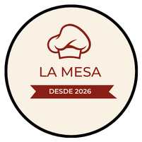
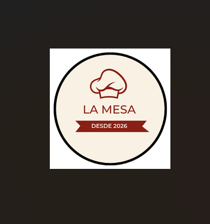
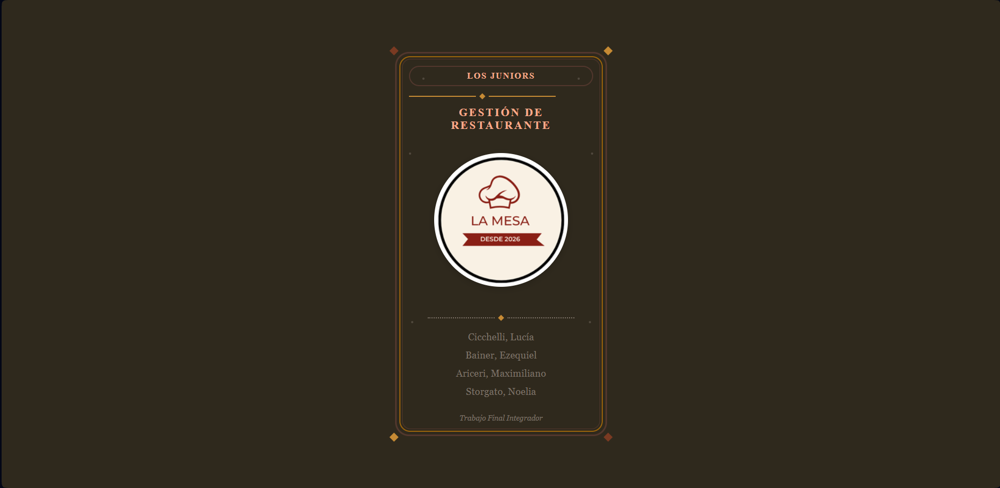
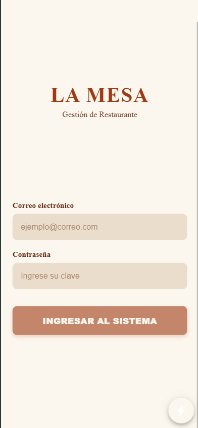
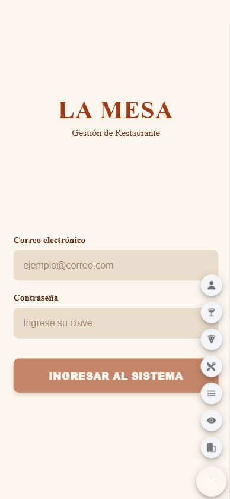
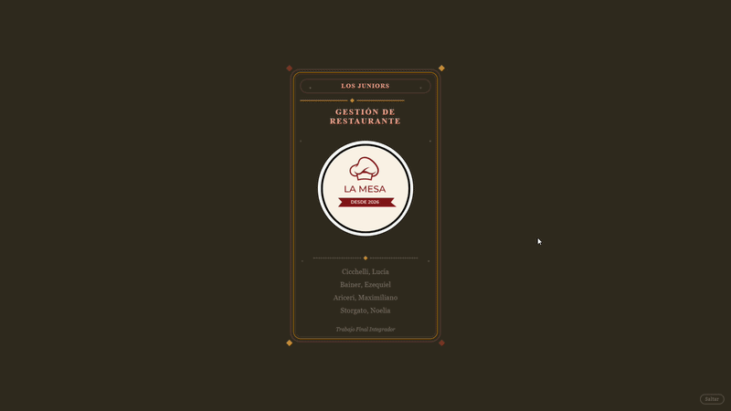

# LA MESA — Comanda QR

### Trabajo Final Integrador · Tecnicatura Universitaria en Programación · UTN

Aplicación móvil para la gestión integral de un restaurante mediante códigos QR.

---

## Índice

- [Descripción del Proyecto](#descripción-del-proyecto)
- [Integrantes](#integrantes)
- [Tecnologías Utilizadas](#tecnologías-utilizadas)
- [Organización del Equipo](#organización-del-equipo)
- [Estado Actual del Proyecto](#estado-actual-del-proyecto)
- [Capturas e Imágenes](#capturas-e-imágenes)
- [Base de Datos](#base-de-datos)

---

## Descripción del Proyecto

Aplicación móvil desarrollada como Trabajo Final Integrador de la Tecnicatura Universitaria en Programación de la UTN.

El sistema permitirá gestionar el funcionamiento de un restaurante mediante el uso de códigos QR, contemplando distintos perfiles de usuario:

| Perfil | Perfil | Perfil |
|---|---|---|
| Dueño | Metre | Cocinero |
| Supervisor | Mozo | Cantinero |
| Cliente | | |

---

## Integrantes

| Integrante |
|------------|
| Ezequiel Bainer |
| Maximiliano Arcieri |
| Noelia Storgato |
| Lucía Cicchelli |

---

## Tecnologías Utilizadas

---

## Organización del Equipo

### Estrategia de Ramas

| Rama | Uso |
|---|---|
| `main` | Rama estable. Solo recibe merges desde `dev` ya probados. |
| `dev` | Rama de integración. Ahí se mergean las ramas individuales para probar que todo funcione antes de pasar a `main`. |
| `Bainer`, `Arcieri`, `Storgato`, `Cicchelli` | Ramas personales de cada integrante para el desarrollo de sus módulos. |

### Integrantes y Módulos

| Integrante | Branch | Período | Módulos desarrollados |
|---|---|---|---|
| **Ezequiel Bainer** | `Bainer` | 22/09/2026 – En progreso | 

Ver detalle
<ul><li>Creación y administración del repositorio GitHub.</li><li>Organización general del proyecto.</li><li>Actualización y mantenimiento del README.</li><li>Investigación inicial de Ionic.</li><li>Investigación inicial de Android Studio.</li><li>Investigación inicial de Capacitor.</li><li>Pantalla de alta de mesa (con tabla y QR).</li></ul>
 |
| **Maximiliano Arcieri** | `Arcieri` | 22/09/2026 – En progreso | 

Ver detalle
<ul><li>Configuración inicial de Supabase.</li><li>Diseño de entidades.</li><li>Creación del esquema inicial de base de datos.</li><li>Implementación de autenticación.</li><li>Configuración de políticas RLS.</li><li>Pantalla de dueño/supervisor con listado de clientes pendientes y botones aceptar/rechazar (integrada con las políticas RLS).</li></ul>
 |
| **Noelia Storgato** | `Storgato` | 22/09/2026 – En progreso | 

Ver detalle
<ul><li>Formulario de Login.</li><li>Pantalla de accesos rápidos.</li><li>Implementación de Logout.</li><li>Creación del proyecto Ionic.</li><li>Flujo de cliente registrado: pantalla de alta, estado "pendiente" y notificación visual del cambio de estado.</li></ul>
 |
| **Lucía Cicchelli** | `Cicchelli` | 22/09/2026 – En progreso | 

Ver detalle
<ul><li>Diseño del ícono de la aplicación.</li><li>Desarrollo de la pantalla de inicio (Splash Screen) estática y animada para el sistema "LA MESA".</li><li>Maquetación modular utilizando Angular y SCSS con paleta cromática temática.</li><li>Implementación de animaciones CSS3 mediante <code>@keyframes</code>, <code>clip-path</code>, efecto de estampado y entradas escalonadas de elementos visuales.</li><li>Botón para omitir la animación.</li><li>Adaptación responsive para distintos dispositivos.</li><li>Compatibilidad con <code>prefers-reduced-motion</code>.</li><li>Diseño visual (mockups / Ionic) de las pantallas de alta de plato y bebida, reutilizando el patrón de formulario del equipo.</li></ul>
 |

---

## Estado Actual del Proyecto

| Tarea | Estado |
|---|:---:|
| Repositorio GitHub creado | ✅ |
| Proyecto Ionic generado | ✅ |
| Configuración inicial de Supabase | ✅ |
| Diseño de entidades | ✅ |
| Esquema inicial de base de datos | ✅ |
| Configuración de autenticación | ✅ |
| Configuración de políticas RLS | ✅ |
| Diseño del ícono de la aplicación | ✅ |
| Diseño del splash screen estático | ✅ |
| Diseño del splash screen animado | ✅ |
| Login | 🔄 |
| Accesos rápidos | 🔄 |
| Logout | 🔄 |
| Integración con Supabase | 🔄 |
| Flujo de cliente registrado (alta, estado pendiente, notificación) | 🔄 |
| Gestión de clientes pendientes (dueño/supervisor: aceptar/rechazar) | 🔄 |
| Alta de mesa (tabla y QR) | 🔄 |
| Diseño visual de alta de plato y bebida | 🔄 |

---

## Capturas e Imágenes

<b>Ver capturas del proyecto</b>

 

<table>
<tr>
<td align="center" width="50%">
<b>Ícono de la aplicación</b>  

</td>
<td align="center" width="50%">
<b>Splash Screen Estático</b>  

</td>
</tr>
<tr>
<td align="center">
<b>Pantalla de Login</b>  

</td>
<td align="center">
<b>Accesos Rápidos</b>  

</td>
</tr>
<tr>
<td align="center" colspan="2">
<b>Splash Screen Animado</b>  

</td>
</tr>
</table>

---

## Base de Datos

La documentación de la base de datos se encuentra en [`/supabase/README.md`](./supabase/README.md).

Incluye:

- Diseño de entidades.
- Esquema SQL inicial.
- Configuración de autenticación.
- Políticas RLS.
- Datos de prueba.
</content>
